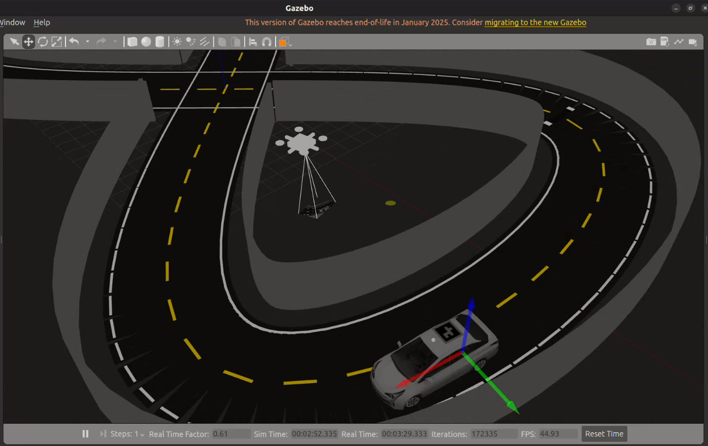
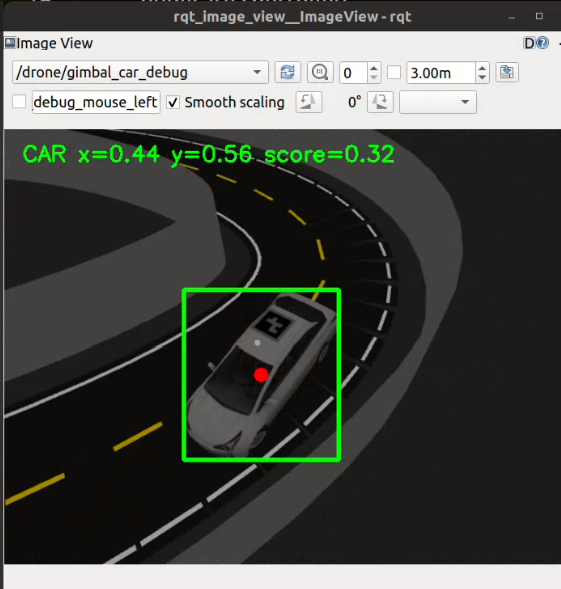
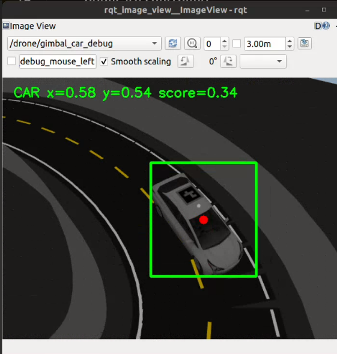
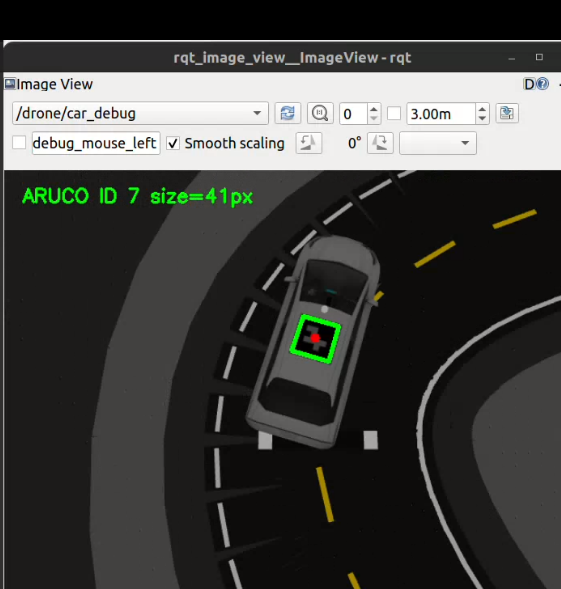
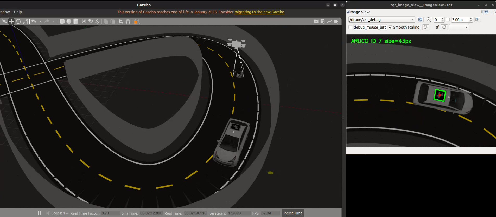

# 🚗🎬 Car-Following Drone Simulation — ROS 2 + Gazebo Classic

A ROS 2 Humble and Gazebo Classic simulation of a Prius-style car followed by a drone. The repository contains **two different drone operating modes**: a **ground-truth cinematic-shot mode** and a **fixed-camera visual-following mode**. The car's lane-following nodes provide autonomous motion in the test world.

<p align="left">
  
  
  
  
</p>

> **Important:** Mode 1 and Mode 2 are two different ways to control the drone's follow behaviour. Do not start both modes at the same time; their launch files spawn their own simulation entities and their controllers can compete for control of the drone.
<!-- PROJECT_MEDIA_GALLERY_START -->
## Simulation Gallery



*Gazebo Classic environment with the car and drone.*

### Mode 1 — Cinematic Shot (Ground Truth)

The drone uses Gazebo ground-truth information for cinematic positioning,
while the gimbal and camera controllers aim the view toward the car.





**Demo:** [Watch the cinematic mode video](media/videos/mode1_cinematic_demo.mp4)

### Mode 2 — Fixed-Camera Visual Following

The fixed camera detects roof-mounted ArUco marker ID 7. The visual-following
controller uses the detection to guide the drone toward the car.





**Demo:** [Watch the fixed-camera visual-following video](media/videos/mode2_visual_follow_demo.mp4)

<!-- PROJECT_MEDIA_GALLERY_END -->

## Project status

## ✨ Main features

- 🎬 **Ground-truth cinematic shot:** `cinematic_follow_controller` uses simulator ground truth for drone positioning; a gimbal-camera detector and autonomous gimbal controller can aim the camera toward the car.
- 🎯 **Fixed-camera visual following:** OpenCV ArUco detector looks for roof marker **ID 7** in `/drone/camera/image_raw`; an image-space follower turns marker location into drone movement commands.
- 🚘 **Autonomous Prius motion:** `lane_detection` and `autonomous_driver` support car lane following in the cinematic test launch and may be started separately when using a launch path that does not start them.
- 🛸 **Separate flight controller:** `drone_flight_controller` applies `/drone/cmd_vel` commands to the simulated drone.
- 🧪 **Evaluation tools:** scripts and CSV templates are included. Detection accuracy and end-to-end success percentages remain **not yet measured** until labelled images and documented trials exist.

---

# 🧭 The two drone modes

## Mode 1 — 🎬 Ground-truth cinematic shot + autonomous gimbal

### What this mode does

Mode 1 is intended for cinematic views of the moving Prius. The drone's position-following controller uses **simulator ground-truth information**, including `/prius/ground_truth` and `/gazebo/model_states`, rather than using the fixed-camera detector's image-space error to decide where the drone should move. The controller publishes movement commands to `/drone/cmd_vel`, and the flight controller applies those commands in Gazebo.

The camera can be aimed separately: `gimbal_car_detector` reads the gimbal-camera view, and `autonomous_gimbal_controller` adjusts the gimbal based on visual tracking. Therefore this mode combines ground-truth-based drone positioning with a visual camera-aiming pipeline; it is not the same as Mode 2's fixed-camera visual follower.

### Mode 1 system flow

```text
Gazebo Prius ground truth                 Gimbal camera image
 /prius/ground_truth                       (camera stream)
 /gazebo/model_states                               |
          |                                         v
          v                              gimbal_car_detector
cinematic_follow_controller                         |
          |                               visual target output
    /drone/cmd_vel                                  |
          |                                         v
          v                          autonomous_gimbal_controller
 drone_flight_controller                            |
          |                               gimbal joint commands
          v                                         v
  Gazebo drone motion                    Camera points toward Prius
```

### Mode 1 — run these terminals in order

Open a separate terminal for each step. In **every terminal**, source ROS 2 and the workspace before running a node. Start from a clean simulation: stop an earlier Mode 1 or Mode 2 run first.

#### Terminal 1 — Start the cinematic simulation

```bash
source /opt/ros/humble/setup.bash
source ~/car_drone_ws/install/setup.bash
ros2 launch drone_description spawn_cinematic_test.launch.py
```

This launch file starts the Gazebo world and spawns the Prius and drone. Its source also starts `lane_detection` and `autonomous_driver`; **do not start duplicate copies of those two nodes while this launch is running**.

Wait until the Gazebo server has started and both models have spawned before starting the other terminals.

#### Terminal 2 — Start the drone flight/model-state controller

```bash
source /opt/ros/humble/setup.bash
source ~/car_drone_ws/install/setup.bash
ros2 run drone_controller drone_flight_controller
```

This node consumes `/drone/cmd_vel` and applies the commanded drone motion in Gazebo. Run exactly one instance.

#### Terminal 3 — Start visual detection for the gimbal camera

```bash
source /opt/ros/humble/setup.bash
source ~/car_drone_ws/install/setup.bash
ros2 run drone_tracker gimbal_car_detector
```

This is the visual detector for the gimbal-camera pipeline. It is separate from the fixed-camera `car_detector` used in Mode 2.

#### Terminal 4 — Start the autonomous gimbal controller

```bash
source /opt/ros/humble/setup.bash
source ~/car_drone_ws/install/setup.bash
ros2 run drone_tracker autonomous_gimbal_controller
```

This node consumes the gimbal detector's target information and controls the camera gimbal. Start the detector first so its output is available. If the gimbal does not move, inspect the active topics and controller logs as described in the verification section below.

#### Terminal 5 — Start the ground-truth cinematic-follow controller

`cinematic_follow_controller.py` is present in `drone_tracker`, but it is **not listed as a `console_scripts` executable in the current `src/drone_tracker/setup.py`**. Until an entry point is added and rebuilt, run the source file directly:

```bash
source /opt/ros/humble/setup.bash
source ~/car_drone_ws/install/setup.bash
python3 ~/car_drone_ws/src/drone_tracker/drone_tracker/cinematic_follow_controller.py
```

This node subscribes to `/prius/ground_truth` and `/gazebo/model_states` and publishes `/drone/cmd_vel`. Start the flight controller first so it is ready to apply the cinematic controller's commands.

### Mode 1 — quick verification

In another terminal:

```bash
source /opt/ros/humble/setup.bash
source ~/car_drone_ws/install/setup.bash

ros2 node list | sort
ros2 topic list | grep -E 'ground_truth|model_states|gimbal|cmd_vel|camera'
ros2 topic info /prius/ground_truth
ros2 topic info /drone/cmd_vel
```

Use the topic list to identify the exact gimbal image/detection topics exposed by the current launch. The verified ground-truth controller interfaces are `/prius/ground_truth`, `/gazebo/model_states`, and `/drone/cmd_vel`.

### What Mode 1 demonstrates

- Drone/camera movement coordinated from the simulator's target state.
- Visual gimbal aiming via `gimbal_car_detector` and `autonomous_gimbal_controller`.
- Cinematic tracking behaviour that does not rely on the fixed-camera follower's image-space control loop.

This mode is not a measurement of fixed-camera detection precision or recall. Evaluate its shot-following success separately.

---

## Mode 2 — 🎯 Fixed-camera visual detection and following

### What this mode does

Mode 2 follows the Prius using the drone's **fixed onboard camera**. `car_detector` processes `/drone/camera/image_raw`, detects ArUco marker **ID 7** on the Prius roof, and publishes normalized marker geometry. `drone_follow_controller` uses that geometry to produce movement commands. `drone_flight_controller` then applies the commands in Gazebo.

Unlike Mode 1, the following decision comes from what is visible in the camera image, not from `/prius/ground_truth`. The drone still uses Gazebo state/model control to enact the movement.

### Mode 2 system flow

```text
Prius roof marker — ArUco ID 7
              |
              v
/drone/camera/image_raw
              |
              v
        car_detector
              |
              v
      /drone/car_detection
              |
              v
   drone_follow_controller
              |
              v
       /drone/cmd_vel
              |
              v
  drone_flight_controller
              |
              v
       Gazebo drone motion
```

### Mode 2 — run these terminals in order

Do not run Mode 1 at the same time. Source ROS and the workspace in each terminal.

#### Terminal 1 — Start the visual-following world

```bash
source /opt/ros/humble/setup.bash
source ~/car_drone_ws/install/setup.bash
ros2 launch drone_description spawn_drone.launch.py
```

Wait for Gazebo and the models to spawn. The launch file configures the drone and Prius descriptions and the `drone_follow.world` simulation.

#### Terminal 2 — Start the flight controller

```bash
source /opt/ros/humble/setup.bash
source ~/car_drone_ws/install/setup.bash
ros2 run drone_controller drone_flight_controller
```

Run one instance only.

#### Terminal 3 — Start the fixed-camera detector and follower

```bash
source /opt/ros/humble/setup.bash
source ~/car_drone_ws/install/setup.bash
ros2 launch drone_tracker drone_follow.launch.py
```

This launch starts both registered executables:

- `car_detector` — detects ArUco ID 7 from the fixed camera.
- `drone_follow_controller` — converts marker image position into `/drone/cmd_vel` commands.

#### Optional — Start autonomous Prius lane following only if it is not already running

First check:

```bash
ros2 node list | grep -E 'lane_detection|autonomous_driver'
```

If those nodes are not running and the spawned world supplies the Prius camera/control topics, start each only once in separate terminals:

**Terminal 4 — Lane detection**

```bash
source /opt/ros/humble/setup.bash
source ~/car_drone_ws/install/setup.bash
ros2 run prius_adas_control lane_detection
```

**Terminal 5 — Autonomous driver**

```bash
source /opt/ros/humble/setup.bash
source ~/car_drone_ws/install/setup.bash
ros2 run prius_adas_control autonomous_driver
```

Do not start duplicate lane-following nodes if the main launch already started them. Check the launch output and `ros2 node list` first.

### Mode 2 — inspect the detector

```bash
source /opt/ros/humble/setup.bash
source ~/car_drone_ws/install/setup.bash

ros2 topic info /drone/camera/image_raw
ros2 topic info /drone/car_detection
ros2 topic info /drone/car_debug
ros2 topic info /drone/cmd_vel
ros2 run rqt_image_view rqt_image_view
```

In `rqt_image_view`, select `/drone/camera/image_raw` or `/drone/car_debug`.

The `/drone/car_detection` message is a `std_msgs/msg/Float32MultiArray` with six values:

| Index | Field | Meaning |
|---:|---|---|
| 0 | `detected` | `0.0` if no target is reported, `1.0` if target ID 7 is reported |
| 1 | `center_x` | Normalized horizontal marker centre (0–1) |
| 2 | `center_y` | Normalized vertical marker centre (0–1) |
| 3 | `box_w` | Normalized marker bounding-box width |
| 4 | `box_h` | Normalized marker bounding-box height |
| 5 | `size_score` | Size heuristic, not a calibrated confidence probability |

The current visual follower has search disabled: after a prolonged marker loss it can enter `HOLD` rather than searching. The detector may also intermittently lose ID 7 around turns or image edges. These are current limitations, not claims of a fully robust tracker.

---

## 🔎 Mode comparison

| Behaviour | Mode 1 — ground-truth cinematic | Mode 2 — fixed-camera visual |
|---|---|---|
| Source for drone follow position | Gazebo ground-truth state | Visual marker position in fixed-camera image |
| Main follow controller | `cinematic_follow_controller.py` | `drone_follow_controller` |
| Camera aiming | Gimbal detector + autonomous gimbal controller | Fixed camera; no gimbal tracking required for the follow loop |
| Target detector | `gimbal_car_detector` for camera aiming | `car_detector` for ID 7 follow feedback |
| Flight actuator/model controller | `drone_flight_controller` | `drone_flight_controller` |
| Good for | Cinematic shot choreography in simulation | Testing vision-based car following |
| Measures fixed-camera detector accuracy? | No | Yes, after testing with ground-truth labels |

---

## 🧩 Other components in the workspace

The workspace also contains Prius lane-following nodes and SLAM Toolbox/Nav2 configuration files. They are supporting or additional ADAS components, not the two drone modes above. The presence of these files does not mean every navigation configuration has been validated from a clean installation.

## 🧱 Software stack

| Component | Role |
|---|---|
| Ubuntu 22.04 | Development OS |
| ROS 2 Humble | Middleware and launch system |
| Gazebo Classic 11 | Vehicle and drone simulation |
| URDF / Xacro | Robot descriptions and sensor configuration |
| Python + OpenCV ArUco | Visual marker detection |
| `colcon` / `rosdep` | Build and dependency management |
| SLAM Toolbox / Nav2 | Additional ADAS experiments |

## 🔧 Install dependencies and build

This repository was developed in an Ubuntu 22.04 + ROS 2 Humble + Gazebo Classic environment. Install packages required by the launch files if they're not already installed:

```bash
sudo apt update
sudo apt install \
  python3-colcon-common-extensions \
  python3-rosdep \
  ros-humble-desktop \
  ros-humble-gazebo-ros-pkgs \
  ros-humble-xacro \
  ros-humble-cv-bridge \
  python3-opencv
```

If `rosdep` is already initialized:

```bash
cd ~/car_drone_ws
rosdep install --from-paths src --ignore-src -r -y
```

Build the workspace:

```bash
source /opt/ros/humble/setup.bash
cd ~/car_drone_ws
colcon build --symlink-install
source ~/car_drone_ws/install/setup.bash
```

Confirm Python OpenCV exposes ArUco:

```bash
python3 -c 'import cv2; print("OpenCV:", cv2.__version__); print("ArUco available:", hasattr(cv2, "aruco"))'
```

For every new terminal used to run ROS commands, source both ROS and the workspace as shown in the mode steps.

## 🗂️ Project structure

```text
car_drone_ws/
├── README.md
├── LICENSE
├── THIRD_PARTY_NOTICES.md
├── docs/
│   ├── ARCHITECTURE.md
│   ├── RESULTS_LOG_TEMPLATE.md
│   └── media/                  # Add screenshots/demo links here
├── evaluation/                 # CSV templates and evaluation instructions
├── tools/                      # Evaluation scripts
└── src/
    ├── car_lane_following/     # Supporting lane-following source
    ├── drone_controller/       # Gazebo drone movement controller
    ├── drone_description/      # Drone, worlds, models, sensors, launch files
    ├── drone_tracker/          # Fixed-camera and gimbal detectors/controllers
    ├── prius_adas_control/     # Prius control and SLAM/Nav2 configurations
    ├── prius_description/      # Prius URDF and ArUco roof-marker assets
    └── prius_msgs/             # Prius-related ROS message definitions
```

## 📊 Evaluation status

| Metric | Current status |
|---|---|
| Mode 2 detector precision / recall / F1 | **Not yet measured on a labelled dataset** |
| Mode 2 end-to-end lap/trial success | **Not yet measured using documented trials** |
| Marker tracking availability and reacquisition time | **Not yet measured** |
| Mode 1 cinematic-shot completion/smoothness | **Not yet measured using a defined shot protocol** |

Evaluation tools and CSV templates are included. Do not enter guessed percentages. Keep Mode 1 and Mode 2 results separate because one uses ground truth for drone positioning while the other follows from fixed-camera image detections.

## ⚠️ Troubleshooting

- **Drone appears but does not move:** make sure exactly one `drone_flight_controller` is running and the active mode's controller publishes to `/drone/cmd_vel`.
- **Mode 1 gimbal does not aim:** verify `gimbal_car_detector` and `autonomous_gimbal_controller` are both running; inspect `ros2 topic list | grep -E 'gimbal|camera'` and the terminal logs before guessing topic names.
- **Mode 1 cinematic controller command fails:** it is not currently registered under `console_scripts`; use the direct Python command shown above, with ROS and workspace sourced.
- **Mode 2 detector does not show ID 7:** inspect `/drone/camera/image_raw` and `/drone/car_debug`, confirm the roof marker is visible, and inspect `ros2 topic echo /drone/car_detection`.
- **Car not moving:** check whether `lane_detection` and `autonomous_driver` are running. Don't start a second copy if they are already launched by the selected world launch.
- **Low frame rate:** Gazebo Classic and camera rendering can be CPU-intensive on lower-powered systems. Closing `rqt_image_view` can reduce GUI load.
- **Long marker-loss periods:** visual-mode search is disabled; the follower may hold position after a prolonged loss.

## 📜 License and third-party assets

Original project code intended for distribution under Apache License 2.0 is licensed under Apache-2.0; see [LICENSE](LICENSE). Third-party packages and assets retain their applicable licences and notices. Review [THIRD_PARTY_NOTICES.md](THIRD_PARTY_NOTICES.md) before redistribution, especially for model meshes, textures, and the compiled Gazebo plugin.

## 🤝 Contributing

Bug reports are most useful when they include the OS, ROS distribution, Gazebo version, selected mode, exact launch commands, relevant `ros2 node list` / `ros2 topic info` output, and logs around a failure. If you contribute code, preserve third-party notices and avoid claiming unmeasured accuracy or performance.
